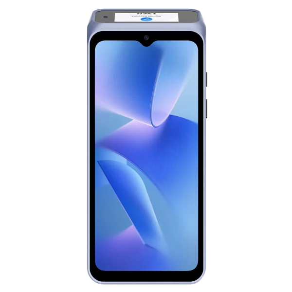
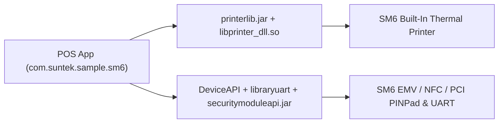

<div align="center">
  <a href="https://www.suntekai.com">
    <picture>
      <source media="(prefers-color-scheme: dark)" srcset="https://raw.githubusercontent.com/SUNTEK-Official/.github/main/profile/assets/logo-dark.png">
      <source media="(prefers-color-scheme: light)" srcset="https://raw.githubusercontent.com/SUNTEK-Official/.github/main/profile/assets/logo-light.png">
      
    </picture>
  </a>

  <h1>SUNTEK SM6 Smart POS Terminal SDK</h1>

  <p>
    <strong>Official Hardware SDK &amp; Developer Kit</strong> &middot; <em>Enjoy Smarter Service</em><br>
    Official Android printer (<code>printerlib.jar</code>), contactless/card reader (<code>DeviceAPI</code>), UART (<code>libraryuart</code>), and PCI PINPad (<code>securitymoduleapi.jar</code>) SDK for <strong>SUNTEK SM6</strong> handheld Smart POS terminals (<strong>SUNTEK Technology Co., Ltd.</strong>).
  </p>

  <p>
    <a href="./LICENSE"></a>
    <a href="https://github.com/SUNTEK-Official/suntek-sdk-sm6/releases"></a>
    
    <a href="https://www.suntekai.com/products/suntek-handheld-pos-terminal-sm6/"></a>
    <a href="mailto:support@suntekai.com"></a>
  </p>

  <p>
    <a href="#hardware-showcase--compatibility">Hardware</a> &nbsp;&bull;&nbsp;
    <a href="#architecture--key-capabilities">Architecture</a> &nbsp;&bull;&nbsp;
    <a href="#supported-interfaces--physical-connections">Interfaces</a> &nbsp;&bull;&nbsp;
    <a href="#5-minute-quick-start">Quick Start</a> &nbsp;&bull;&nbsp;
    <a href="#sample-apps--prebuilt-downloads">Downloads</a> &nbsp;&bull;&nbsp;
    <a href="#troubleshooting--faq">FAQ</a> &nbsp;&bull;&nbsp;
    <a href="#documentation-changelog--support">Support</a>
  </p>
  
</div>

---

## Hardware Showcase & Compatibility

<table>
  <tr>
    <td align="center" width="38%">
      <a href="https://www.suntekai.com/products/suntek-handheld-pos-terminal-sm6/">
        
      </a>
      <br>
      <strong>SM6</strong><br>
      <sub>Android Handheld Smart POS</sub><br>
      <a href="https://www.suntekai.com/products/suntek-handheld-pos-terminal-sm6/">Official Product Page</a>
    </td>
    <td valign="top" width="62%">
      <ul>
        <li><strong>High-Speed Thermal Printer</strong>: <code>printerlib.jar</code> + 16 KB page-aligned <code>libprinter_dll.so</code></li>
        <li><strong>Card &amp; Security Modules</strong>: Complete <code>DeviceAPI_ver20231031_release.aar</code>, <code>securitymoduleapi.jar</code> &amp; <code>libraryuart-release.aar</code></li>
        <li><strong>Multi-Interface Control</strong>: Built-in Beep, RTC clock, LED status, ICC/NFC, and UART expansion</li>
        <li><strong>Ready-to-Build Sample</strong>: Pre-linked <code>sample-android/</code> against all 4 real SDK libraries</li>
      </ul>
    </td>
  </tr>
</table>

| Product Model | Chipset / Board | OS Versions | Build Identifier | Status |
| :--- | :--- | :--- | :--- | :---: |
| **SM6** | Smart POS ARM Platform | Android 11 - 14 (PCI PTS) | `SM6*` | Supported |

> [!IMPORTANT]
> Verify your device **Model** and **Build Number** under Android **Settings -> About device** before integration. Customer applications use your own Google Play or enterprise release certificate.

---

## Architecture & Key Capabilities

- **16 KB Aligned Thermal Printing**: Ships `printerlib.jar` paired with 16 KB ELF page-aligned `arm64-v8a/libprinter_dll.so`.
- **Complete Card, PINPad & UART SDKs**: Includes `DeviceAPI_ver20231031_release.aar`, `libraryuart-release.aar`, and `securitymoduleapi.jar` directly in `sdk/` and `sample-android/app/libs/`.
- **Complete API Guide**: Converted pure English General API guide (`docs/sm6-general-api-guide.md`) aligned with the bundled libraries.



---

## Supported Interfaces & Physical Connections

| Hardware Feature | Interface Type | Device Path / Service Target | Notes |
| :--- | :--- | :--- | :--- |
| **Thermal Printer SDK** | Native JNI + Java (`com.pos.devices.Printer`) | `sdk/printerlib.jar + sdk/jniLibs/arm64-v8a/libprinter_dll.so` | 16 KB ELF page-aligned (`arm64-v8a`) |
| **Card Reader & Biometric SDK** | Java + JNI (`com.rscja.deviceapi.*`) | `sdk/DeviceAPI_ver20231031_release.aar` | ICC, contactless RFID/NFC & PSAM interfaces |
| **PCI Security & PINPad** | AIDL IPC (`com.pos.aidl.device.*`) | `sdk/securitymoduleapi.jar` | Binds `PinEntry.apk` / `loadtools.apk` (Releases) |
| **Serial UART Expansion** | Android AAR (`libraryuart-release.aar`) | `sdk/libraryuart-release.aar` | External RS-232 / TTL peripheral I/O |

---

## Repository Directory Layout

```text
suntek-sdk-sm6/
├── assets/                 # Hero banner & SM6 product render
├── sdk/
│   ├── DeviceAPI_ver20231031_release.aar
│   ├── libraryuart-release.aar
│   ├── printerlib.jar
│   ├── securitymoduleapi.jar
│   └── jniLibs/arm64-v8a/libprinter_dll.so
├── docs/
│   └── sm6-general-api-guide.md
├── sample-android/         # Android Studio sample project (com.suntek.sample.sm6)
├── README.md
├── LICENSE
├── THIRD_PARTY_NOTICES.md
└── CHANGELOG.md
```

> All installers (`.exe`), compiled sample APKs (`.apk`), and large binary packages (> 5 MB) are hosted on [**GitHub Releases**](https://github.com/SUNTEK-Official/suntek-sdk-sm6/releases) with `SHA256SUMS.txt`.

---

## Prerequisites & Permissions

- **Platform Target**: `minSdk 24` / `targetSdk 35`
- **App Signing Requirement**: Use your standard application release key (binds via IPC with `PinEntry.apk` and `loadtools.apk`).
- **Required Permissions / Capabilities**: Printer, card reader, UART, and fiscal security module permissions.

---

## 5-Minute Quick Start

### Step 1: Add SM6 SDK Libraries

```gradle
dependencies {
    implementation fileTree(dir: 'libs', include: ['*.jar', '*.aar'])
}
```

### Step 2: Initialize Printer & Contactless Card Reader

```java
import com.pos.devices.Printer;
import com.rscja.deviceapi.RFIDWithISO14443A;

int prnStatus = Printer.DLL_PrnInit();
RFIDWithISO14443A rfid = RFIDWithISO14443A.getInstance();
```

### Build & Run Sample Project

```bash
cd sample-android && ./gradlew assembleDebug
```

---

## Sample Apps & Prebuilt Downloads

Verified prebuilt APKs, offline SDK bundles, and checksum manifests are published on [**GitHub Releases**](https://github.com/SUNTEK-Official/suntek-sdk-sm6/releases). Verify downloaded archives before production deployment:

```bash
shasum -a 256 -c SHA256SUMS.txt
```

---

## Troubleshooting & FAQ

<details>
<summary><b>Where are `PinEntry.apk` and `loadtools.apk`?</b></summary>
<p>All prebuilt terminal system APKs live under GitHub Releases Assets with `SHA256SUMS.txt` verification.</p>
</details>

<details>
<summary><b>How do I build and run the Android sample project?</b></summary>
<p>Open `sample-android/` in Android Studio (`minSdk 24`, `targetSdk 35`) — all 4 `.jar`/`.aar` libraries and `libprinter_dll.so` are already bundled inside.</p>
</details>

<details>
<summary><b>Is `libprinter_dll.so` compatible with Android 15/16 16 KB page sizes?</b></summary>
<p>Yes. The included `arm64-v8a/libprinter_dll.so` is compiled with `0x4000` (16 KB) PT_LOAD alignment.</p>
</details>

---

## Documentation, Changelog & Support

- **Changelog**: [CHANGELOG.md](./CHANGELOG.md)
- **Developer Documentation Portal**: [suntek-docs](https://github.com/SUNTEK-Official/suntek-docs)
- **Technical Support**: [support@suntekai.com](mailto:support@suntekai.com)
- **Bug Reports**: [Open an Issue](https://github.com/SUNTEK-Official/.github/issues/new/choose)
- **Security Disclosures**: See [SECURITY.md](https://github.com/SUNTEK-Official/.github/blob/main/SECURITY.md) or email [support@suntekai.com](mailto:support@suntekai.com)

---

<div align="center">
  
  <br><br>
  <strong>SUNTEK Technology Co., Ltd.</strong> &mdash; <em>Smart Commercial Terminal Hardware Manufacturer Since 2010</em><br>
  <sub>80+ Export Countries &middot; 5,000,000+ Terminals Shipped &middot; 500+ ODM Projects &middot; ISO 9001 / ISO 14001 / ISO 27001 / CE / RoHS</sub><br>
  <sub><a href="https://www.suntekai.com">www.suntekai.com</a> &middot; Copyright &copy; 2026 SUNTEK Technology Co., Ltd. All rights reserved.</sub>
</div>
